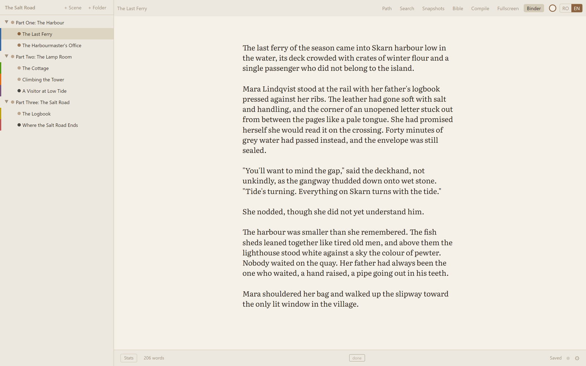
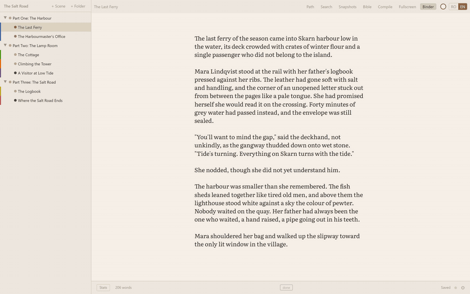
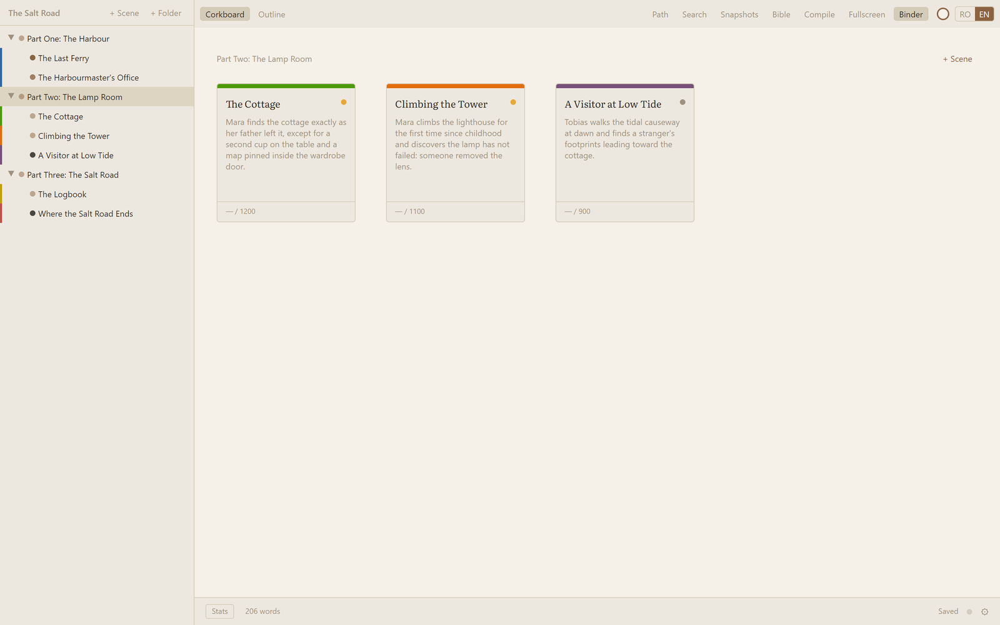
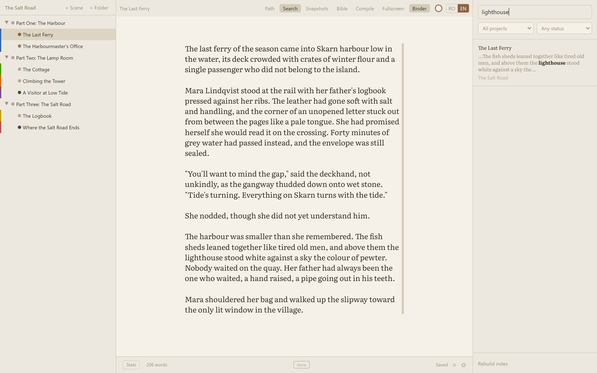
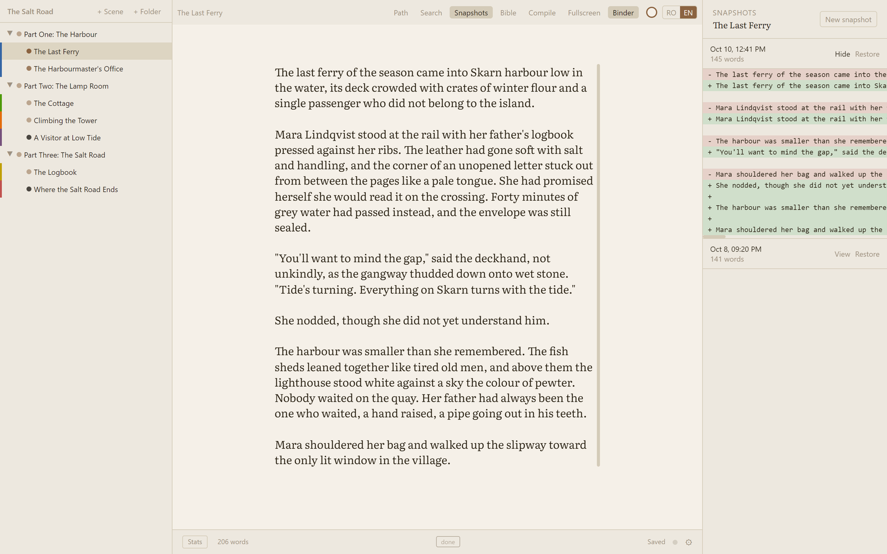
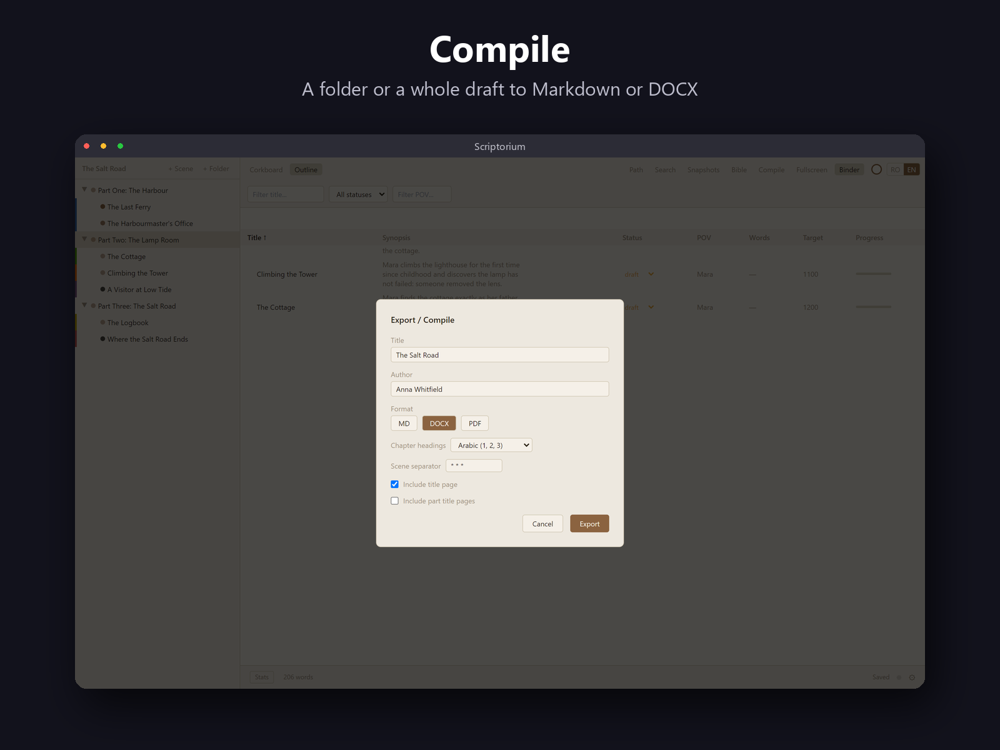
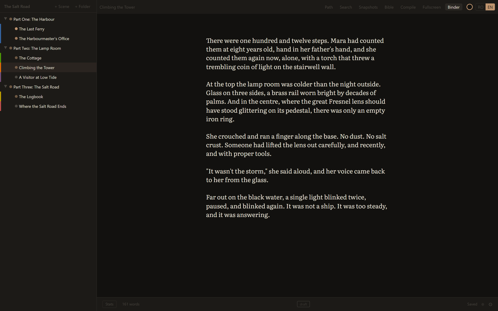

# Scriptorium

A calm local writing app for short stories and novels. Scrivener's structure, iA Writer's calm. Runs entirely offline, forever.

Scriptorium is an offline desktop app for Windows that keeps a novel as a binder of plain Markdown scenes, with corkboard and outline views, snapshots, full-text search and Markdown/DOCX export. Built with Electron, React, TypeScript, CodeMirror 6, Zustand, Tailwind CSS and SQLite (FTS5); tested with Vitest and Playwright.

<p align="center">
  
</p>

- **A binder, not a folder.** Scenes and folders reorder by drag; the hierarchy lives in `project.json`, never in filenames. Corkboard and outline views over the same tree.
- **Your prose stays yours.** Every scene is a plain `.md` file containing nothing but your words. Atomic writes, a daily zip backup, per-scene snapshots, and a crash journal that survives a hard kill.
- **The Path.** An optional curriculum panel that walks a beginner from concrete description to a finished short story in six stages of small, checkable steps — beside the page, never inside it.
- **Full-text search** across every scene in the library, via SQLite FTS5.
- **Compile** a folder or a whole draft to Markdown or DOCX.
- 16 themes, 7 typefaces, typewriter scrolling, focus mode, and a Romanian/English interface.

## Screenshots



<table>
  <tr>
    <td width="50%"><br><sub>Corkboard: scene cards with synopses, colour labels and word targets for one part.</sub></td>
    <td width="50%"><br><sub>Full-text search across the library (SQLite FTS5) with the match highlighted in context.</sub></td>
  </tr>
  <tr>
    <td width="50%"><br><sub>Snapshots panel with a line diff against an earlier version of a scene.</sub></td>
    <td width="50%"><br><sub>Compile dialog: chapter headings and a title page, exported to Markdown or DOCX.</sub></td>
  </tr>
  <tr>
    <td width="50%"><br><sub>The same editor in the dark "nocturne" theme.</sub></td>
    <td></td>
  </tr>
</table>

The screenshots use a fictional demo novel.

## Running in development

```
npm install
npm run dev
```

## Building the installer

```
npm run dist
```

Produces `dist-installer/Scriptorium Setup.exe`.

## Where your files live

| What | Where | Why |
|------|-------|-----|
| Library (projects, scenes) | `Documents\Scriptorium\` | Configurable in Settings, or in `config.json` |
| Backups | `%USERPROFILE%\Scriptorium-Backups\` | Daily zip, 14 kept. Point this at another drive if you have one |
| App config | `%APPDATA%\scriptorium\config.json` | Theme, font, language, library path |
| Daily word counts | `%APPDATA%\scriptorium\daily-words.json` | Feeds the stats panel |
| Crash journals | `%APPDATA%\scriptorium\crash-journals\` | Autosaved buffer state |

## Your prose is plain Markdown

Every scene is a `.md` file containing only your prose — no frontmatter, no metadata. Open any file in Notepad and find nothing but your words. The hierarchy lives in `project.json`, not in filenames.

## Theme JSON schema

Each file in `themes/` defines one theme. Copy any file, change the `id`, and restart.

| Field | Type | Description |
|-------|------|-------------|
| id | string | Identifier used in config |
| name | string | Display name |
| page | hex | Editor/page background |
| prose | hex | Body text color |
| dim | hex | Muted text and icons |
| chrome | hex | Sidebar and panel backgrounds |
| border | hex | Subtle dividers |
| accent | hex | Caret, progress bars, selection |
| selection | hex | Text selection background |
| isLight | boolean | true for light themes |

## Manual backup and restore

**Backup**: Copy your library folder to any other drive.  
**Restore**: Replace the library folder with the backup copy.  
The app stores nothing besides the library folder and `%APPDATA%\scriptorium\`.

## Adding iA Writer Quattro

1. Download from https://github.com/iaolo/iA-Fonts (OFL-1.1 license)
2. Copy `iA Writer Quattro S Regular.ttf` and italic/bold variants to `fonts/`
3. The app will use them automatically (falls back to JetBrains Mono if absent)

## Running tests

```
npm test              # Vitest unit tests
npm run test:e2e      # Playwright e2e tests
```

## Keep backups on a different drive

A single disk failure taking both your originals and your backups is the only truly unrecoverable scenario. The app writes a dated zip of the whole library once a day and keeps the last fourteen — but both default locations sit on the same disk. If you have a second drive, point **Settings → Backups folder** at it.
